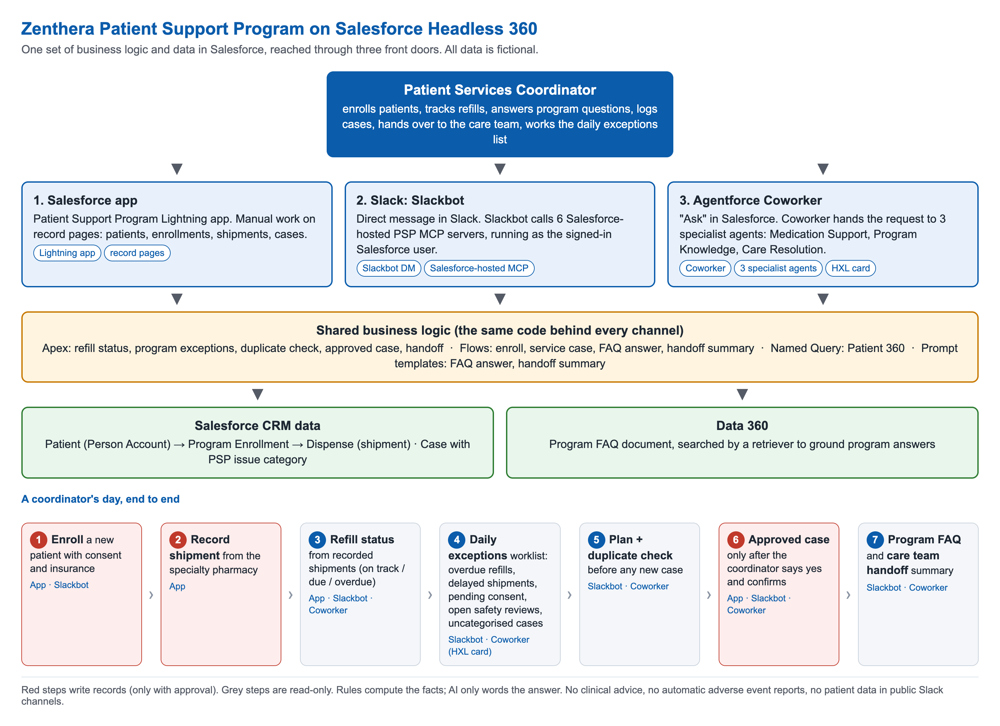

# Zenthera Patient Support Program on Salesforce Headless 360

RFP demo / proof of concept. A pharma company runs a patient support program (PSP) for its specialty drug **Zenthera**. A **Patient Services Coordinator** enrolls patients, tracks refills, answers program questions, logs service cases and possible side effects, hands patients over to the care team and works a daily list of program exceptions.

The demo shows **Salesforce Headless 360**: the data and business rules live once in Salesforce, and the coordinator reaches them through three channels.

> **All data is fictional.** Zenthera is a made-up drug and every patient is a demo record. No real patient data (PHI) is used.



## Channels

| Channel | Where the coordinator works | How it reaches Salesforce |
|---|---|---|
| Salesforce app | **Patient Support Program** Lightning app | Standard record pages and list views |
| Slack | **Slackbot** in a direct message | 6 Salesforce-hosted **PSP MCP servers**; every tool runs as the linked Salesforce user |
| Salesforce AI | **Agentforce Coworker** ("Ask") and the Agentforce panel | 3 specialist agents written in Agent Script: Medication Support, Program Knowledge, Care Resolution. Exceptions are shown as an **HXL worklist card** |

Not in scope: MuleSoft Agent Fabric (optional next step) and AI clients outside Salesforce and Slack.

## Use cases

| # | Use case | Salesforce app | Slackbot | Coworker |
|---|---|---|---|---|
| 1 | Enroll a new patient | Yes | Yes | No |
| 2 | Check refill status (from recorded shipments) | Yes | Yes | Yes |
| 3 | See a patient's full profile (Patient 360) | Yes | Yes | No |
| 4 | Log a service case or a possible side effect | Yes | Yes | Yes, only after approval and confirmation |
| 5 | Answer a program question (FAQ in Data 360) | No | Yes | Yes |
| 6 | Care team handoff summary (read-only) | No | Yes | Yes |
| 7 | Work today's program exceptions | No | Yes | Yes, as an HXL card plus a resolution plan |

## Design principles

1. **One logic, many channels.** Slackbot tools and agent actions call the same Apex classes and Flows.
2. **Rules decide the facts; AI only writes words.** Refill dates, exceptions and duplicates are computed by Apex.
3. **Read-only by default.** Only the Enroll flow, the Create Service Case flow and `PSP_CreateApprovedCase` write records, each after explicit user approval.
4. **User mode everywhere.** Queries and writes run as the signed-in user, so sharing and field security apply.
5. **Never guess.** Missing data is reported as a data gap. No clinical advice, no automatic adverse event reports, no patient data in public Slack channels. Refill status reflects recorded shipments only, not whether the patient takes the medicine.

## Repository layout

| Path | Contents |
|---|---|
| `force-app/main/default/classes/` | Apex: `PSP_RefillHistoryTool`, `PSP_ProgramExceptionRules`, `PSP_ProgramExceptionsService`, `PSP_CaseDuplicateCheck`, `PSP_CreateApprovedCase`, `PSP_CareTeamHandoff`, `PSP_ExceptionsWorklistCard(Action)`, tests and `PSP_TestDataFactory` |
| `force-app/main/default/flows/` | `PSP_Enroll_Patient`, `PSP_Create_Service_Case`, `PSP_Answer_Program_Question`, `PSP_Care_Team_Handoff_Summary` |
| `force-app/main/default/aiAuthoringBundles/`, `bots/`, `genAiPlannerBundles/` | The three specialist agents (Agent Script source and published versions) |
| `force-app/main/default/mcpServerDefinitions/` | 6 PSP MCP servers used by Slackbot |
| `force-app/main/default/apiNamedQueries/` | `PSPPatient360` Named Query |
| `force-app/main/default/genAiPromptTemplates/` | `PSP_Program_FAQ_Answer`, `PSP_Care_Team_Handoff_Summary` |
| `force-app/main/default/lightningTypes/`, `uiWidgets/` | HXL worklist card (Lightning Type and UI Widget) |
| `force-app/main/default/objects/` | `Program_Enrollment__c`, `Dispense__c`, Case PSP fields, PSP Patients list view, PSP Patient compact layout |
| `force-app/main/default/permissionsets/` | `PSP_Patient_Services`, `PSP_Specialist_Agent_Access` |
| `force-app/main/default/applications/`, `layouts/`, `tabs/` | Patient Support Program app, layouts and tabs |
| `docs/` | Documentation (see below), Program FAQ source, evidence screenshots |
| `scripts/apex/psp-demo-preflight.apex` | Read-only check of the demo data before a demo |
| `tools/evidence-guide/` | Python scripts that ran the live UI, took the screenshots and build the Evidence Guide |

This repository holds only the PSP project. The rest of the demo org's metadata is kept out by the whitelist in `.gitignore`.

## Documentation

| Document | Read it for |
|---|---|
| [docs/TDD.md](docs/TDD.md) | Technical Design Document: architecture, data model, every class, flow, MCP server and agent, testing, deployment. Self-contained, suitable for asking an AI assistant questions about the build |
| [docs/User-Guide.md](docs/User-Guide.md) | How to use the demo, step by step |
| [docs/Demo-Script-Program-Exceptions-Desk.md](docs/Demo-Script-Program-Exceptions-Desk.md) | Presenter script with prompts and expected answers |
| [docs/Plan-Program-Exceptions-Desk.md](docs/Plan-Program-Exceptions-Desk.md) | Phase plan and execution log of the Program Exceptions Desk |
| [docs/PSP-Evidence-Guide.docx](docs/PSP-Evidence-Guide.docx) | Live execution evidence with screenshots for every channel |
| [docs/Agent-Utilization-and-Cost-Guide.md](docs/Agent-Utilization-and-Cost-Guide.md) | How to measure agent usage, cost and effectiveness, design rules for low token use, and the POC agents' footprint |
| [docs/Agent-Cost-Precheck-Runbook.md](docs/Agent-Cost-Precheck-Runbook.md) | Step-by-step, Salesforce UI only: check an agent's credit and token use before deploying it |
| [docs/PSP-Medication-Support-Agent-Performance-Cost-Run.docx](docs/PSP-Medication-Support-Agent-Performance-Cost-Run.docx) | The performance and cost guide run on the Medication Support Agent: every step with screenshots, measured actions, tokens and latency, v6 vs v7, sign-off |

## Deploy and test

Prerequisites in the target org: Person Accounts, Agentforce (employee agents), Agentforce Coworker, Einstein Prompt Templates, Data 360 (for the FAQ library) and a Slack workspace connected to the org.

```bash
# Always dry-run first, then deploy
sf project deploy start --dry-run --source-dir force-app --target-org <alias>
sf project deploy start --source-dir force-app --target-org <alias>

# Run all PSP Apex tests
sf apex run test --class-names PSP_RefillHistoryToolTest --class-names PSP_ProgramExceptionRulesTest \
  --class-names PSP_ProgramExceptionsServiceTest --class-names PSP_CaseDuplicateCheckTest \
  --class-names PSP_CreateApprovedCaseTest --class-names PSP_CareTeamHandoffTest \
  --class-names PSP_ExceptionsWorklistCardActionTest --class-names PSP_CaseInsertSmokeTest \
  --code-coverage --result-format human --target-org <alias> --wait 20
```

A fresh environment needs a set order and several Setup steps: the data library, activating the Named Query and the MCP servers, publishing the agents, turning on Coworker and connecting Slack. Follow **TDD section 20.3, Deployment order for a new environment**.

## Safety rules for this demo

- Fictional records only. Never change consent, insurance, shipment status or clinical facts to make a demo work, and do not delete CRM records.
- Case creation from Coworker happens only after the coordinator approves and confirms it; duplicates are checked first.
- Case edits through the REST API must send the header `Sforce-Auto-Assign: FALSE`.
- Never commit credentials, session URLs or browser profiles (`tools/evidence-guide/.profile-*` is ignored).
